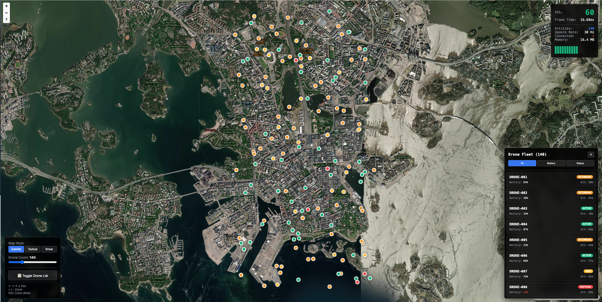

# Tactical Map Dashboard



> Real-time drone fleet visualization with micro-frontend architecture and 30 Hz WebSocket streaming

[](https://d3lnt5s5ggl9sc.cloudfront.net/)
[](https://www.typescriptlang.org/)
[](https://react.dev/)
[](https://webpack.js.org/concepts/module-federation/)

**[View Live Demo →](https://d3lnt5s5ggl9sc.cloudfront.net/)**

A production-grade demonstration of real-time geospatial visualization built with micro-frontend architecture. Tracks 100 drones at 30 Hz update rate (3,000 updates/sec) while maintaining 60 FPS.


## Key Features

- **Real-time WebSocket Streaming** - 30 Hz binary protocol for efficient data transfer
- **Micro-Frontend Architecture** - Independent deployment of UI components using Module Federation
- **Web Worker Processing** - Offloaded binary parsing keeps UI thread at 60 FPS
- **Production AWS Deployment** - CloudFront, S3, EC2 with nginx SSL proxy
- **Type-Safe Contracts** - Shared TypeScript types across all micro-frontends
- **Performance Monitoring** - Live FPS, frame time, and update rate tracking

## Architecture

This project demonstrates production-grade micro-frontend patterns using:

- **Module Federation** - Independent deployment of remotes
- **pnpm Workspaces** - Monorepo package management
- **Turborepo** - Build orchestration and caching
- **Shared Contracts** - Type-safe communication via TypeScript
- **Event Bus** - Cross-remote communication pattern

### Project Structure

```
tactical-map-demo/
├── apps/
│   ├── shell/              # Host application (loads all remotes)
│   ├── map-remote/         # MapLibre-based map widget
│   ├── perf-remote/        # Performance monitoring overlay
│   ├── controls-remote/    # Demo controls panel
│   └── data-simulator/     # WebSocket server with binary protocol
├── packages/
│   └── contracts/          # Shared TypeScript types & contracts
├── turbo.json              # Turborepo configuration
├── pnpm-workspace.yaml     # Workspace definition
└── package.json            # Root scripts
```

## Features

- 🗺️ **MapLibre GL JS** for high-performance rendering
- ⚡ **30 Hz real-time updates** via WebSocket with binary protocol
- 🧵 **Web Worker** for data processing (keeps UI thread responsive)
- 📊 **Live FPS and performance metrics**
- 🎨 **Micro-frontends** - independently deployable remotes
- 🔌 **Graceful degradation** - remotes can fail without crashing app
- 📦 **Type-safe contracts** - shared TypeScript interfaces

## Tech Stack

| Technology        | Purpose                               |
| ----------------- | ------------------------------------- |
| React 19          | UI framework with concurrent features |
| TypeScript        | Type safety across micro-frontends    |
| MapLibre GL       | High-performance map rendering        |
| Module Federation | Micro-frontend runtime                |
| Web Workers       | Offload binary parsing                |
| WebSocket         | Real-time data streaming              |
| Turborepo         | Monorepo orchestration                |
| pnpm              | Fast, efficient package manager       |
| Vite              | Lightning-fast dev server             |

## Quick Start

### Prerequisites

- Node.js >= 20
- pnpm >= 9

### Installation

```bash
# Install all dependencies
pnpm install
```

### Development

```bash
# Start all apps in parallel (shell + 3 remotes + simulator)
pnpm dev

# Or start individually:
pnpm dev:shell      # Shell only (requires remotes to be running)
pnpm dev:remotes    # All remotes only

# Verbose output (see all logs)
pnpm dev:verbose
```

This will start:

- Shell (host): http://localhost:5000
- Map Remote: http://localhost:5001
- Perf Remote: http://localhost:5002
- Controls Remote: http://localhost:5003
- WebSocket Simulator: ws://localhost:8080

### Build for Production

```bash
# Build all apps
pnpm build

# Type check all packages
pnpm typecheck

# Clean all build artifacts
pnpm clean
```

## Micro-Frontend Architecture

### Host → Remote Contract

The shell provides a `HostAPI` to all remotes:

```typescript
interface HostAPI {
  eventBus: {
    subscribe<T>(event: string, handler: (data: T) => void): () => void;
    publish<T>(event: string, data: T): void;
  };
  getDroneData(): Map<string, DroneData>;
  reportError(remote: string, error: Error): void;
  reportMetric(name: string, value: number): void;
}
```

### Cross-Remote Communication

Remotes communicate via event bus (no direct imports):

```typescript
// Map remote publishes drone selection
hostAPI.eventBus.publish("drone:selected", { droneId: "DRONE-001" });

// Controls remote subscribes to updates
hostAPI.eventBus.subscribe("drone:update", (event) => {
  // Handle update
});
```

### Independent Deployments

Each remote can be deployed separately:

```bash
cd apps/map-remote
pnpm build
# Deploy dist/ to CDN

# Update shell to point to new URL
remotes: {
  mapRemote: 'https://cdn.example.com/map-remote/v1.2.4/remoteEntry.js'
}
```

## Production Deployment

### Live Infrastructure

The application is deployed on AWS with the following architecture:

```
┌─────────────────────────────────────────────────────────────┐
│                    Production Architecture                   │
├─────────────────────────────────────────────────────────────┤
│                                                               │
│  CloudFront CDN (https://d3lnt5s5ggl9sc.cloudfront.net/)    │
│  ├─ Shell App (S3)                                           │
│  ├─ Map Remote (S3)                                          │
│  ├─ Perf Remote (S3)                                         │
│  └─ Controls Remote (S3)                                     │
│                                                               │
│  EC2 WebSocket Server (wss://16.192.137.161)                 │
│  ├─ Node.js WebSocket server (port 8080)                    │
│  ├─ nginx SSL reverse proxy (port 443)                      │
│  └─ Binary protocol (32 bytes/drone)                        │
│                                                               │
└─────────────────────────────────────────────────────────────┘
```

### Deployment Details

- **Frontend**: CloudFront + S3 for all micro-frontends
- **Backend**: EC2 t3.micro with nginx SSL termination
- **WebSocket**: Secure WSS connection with self-signed certificate
- **Binary Protocol**: Custom 32-byte format (Float32 coordinates)
- **Auto-scaling**: Ready for load balancer + multiple EC2 instances

See [DEPLOYMENT.md](./DEPLOYMENT.md) for complete deployment guide.

## Design Decisions

### Why MapLibre over Leaflet?

- Better performance with large entity counts (500+)
- Built-in WebGL rendering
- More active development for high-performance use cases

### Why Binary Protocol?

- JSON: ~2KB per update (100 drones)
- Binary: ~800 bytes per update
- 60% smaller payload = lower bandwidth costs

### Why Module Federation?

- Independent deployments without rebuilding host
- Runtime sharing (single React instance)
- Graceful degradation (one remote fails ≠ app fails)
- Team autonomy (separate repos possible)

## Technical Highlights

This project demonstrates:

✅ **Micro-Frontend Architecture** - Module Federation with host/remote contracts and independent deployments
✅ **Performance Engineering** - Web Workers, binary protocols, 60 FPS with 500 entities
✅ **Real-Time Data Processing** - 30 Hz WebSocket streaming with sub-20ms frame times
✅ **Type Safety** - Shared TypeScript contracts ensure compatibility across micro-frontends
✅ **Production Deployment** - Full AWS infrastructure with CDK, CloudFront, S3, and EC2
✅ **Error Handling** - Error boundaries, graceful degradation, telemetry integration
✅ **Modern Tooling** - Turborepo, pnpm workspaces, Vite, TypeScript strict mode
✅ **DevOps** - Infrastructure as Code, automated builds, CloudFront cache invalidation

## Development Tips

### Standalone Remote Development

Each remote can run independently:

```bash
cd apps/map-remote
pnpm dev
# Visit http://localhost:5001
```

### Debugging Module Federation

```bash
# Check if remote is accessible
curl http://localhost:5001/assets/remoteEntry.js

# Enable verbose federation logs
DEBUG=vite-plugin-federation:* pnpm dev
```

### Type Checking

```bash
# Check all packages
pnpm typecheck

# Check specific app
cd apps/shell
pnpm typecheck
```

## Documentation

- **[ARCHITECTURE.md](./ARCHITECTURE.md)** - Detailed system architecture and design decisions
- **[DEPLOYMENT.md](./DEPLOYMENT.md)** - Complete deployment guide for AWS and other platforms
- **[QUICK_DEPLOY.md](./QUICK_DEPLOY.md)** - Quick start deployment instructions

## Future Enhancements

- [ ] Add historical playback with timeline scrubber
- [ ] Implement geofencing with polygon drawing
- [ ] Add E2E tests with Playwright
- [ ] Implement offline support with service worker
- [ ] Add authentication and session management
- [ ] Spatial indexing for viewport culling (10,000+ entities)
- [ ] Replace self-signed cert with Let's Encrypt
- [ ] ...

## Contributing

This is a demonstration project, but contributions are welcome! Please feel free to:

1. Fork the repository
2. Create a feature branch (`git checkout -b feature/amazing-feature`)
3. Commit your changes (`git commit -m 'Add amazing feature'`)
4. Push to the branch (`git push origin feature/amazing-feature`)
5. Open a Pull Request

## License

MIT - See [LICENSE](./LICENSE) for details
